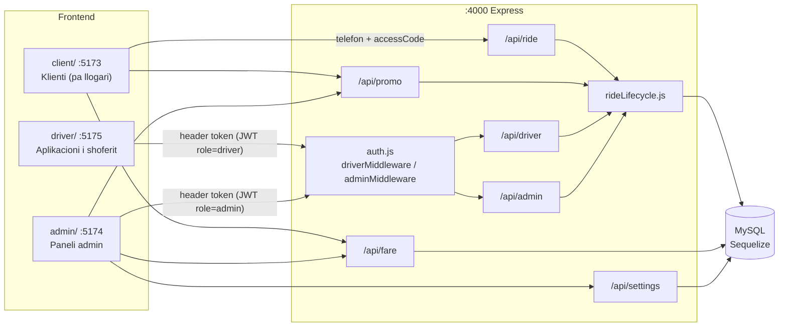
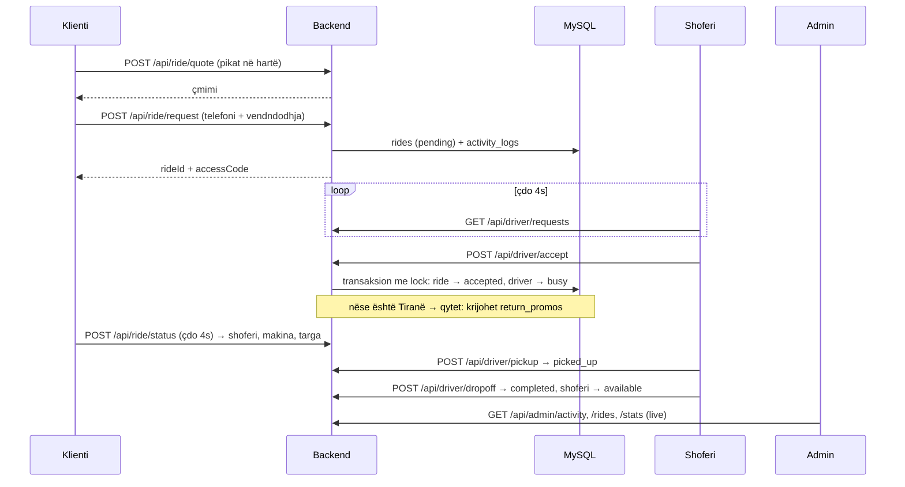

# Skema e backend-it

Express 5 + Sequelize 6 + MySQL, me ES Modules dhe të njëjtën strukturë si projektet e tjera: **models → controllers → routes → server.js**.

```text
backend/
├── server.js              # Express, CORS, rrugët, pastrimi çdo minutë
├── config/
│   ├── database.js        # lidhja Sequelize me MySQL (nga .env)
│   └── constants.js       # qendra e Tiranës, statuset, llojet
├── models/                # një model për tabelë + index.js me lidhjet
├── controllers/           # logjika e çdo endpoint-i
├── routes/                # rrugët Express dhe middleware-t
├── middleware/
│   ├── auth.js            # JWT për shoferin dhe adminin
│   └── rateLimit.js       # kufizim kërkesash për IP
├── utils/
│   ├── pricing.js         # distanca (haversine), çmimi brenda Tiranës
│   ├── phone.js           # normalizimi i numrave shqiptarë
│   ├── activity.js        # shkrimi në activity_logs
│   └── rideLifecycle.js   # anulimi, ofertat e kthimit, skadimet
├── seed/seed.js           # admini, tarifat fillestare, shoferë demo
└── test/                  # node --test
```

## Arkitektura



## Identifikimi

| Kush | Si identifikohet |
|---|---|
| **Klienti** | Pa llogari. Kur porosit, merr `rideId` + `accessCode` (48 karaktere të rastësishme) që ruhen në shfletues. Me to shikon statusin dhe anulon. |
| **Shoferi** | `POST /api/driver/login` me telefon + fjalëkalim → JWT (`role: driver`, 7 ditë) në header-in `token`. Llogarinë e krijon admini. |
| **Admini** | `POST /api/admin/login` me email + fjalëkalim → JWT (`role: admin`). Admini i parë krijohet nga `npm run seed`. |

## Rrjedha e një porosie



Pranimi bëhet në transaksion me `SELECT … FOR UPDATE`, kështu që edhe kur dy shoferë shtypin "Prano" njëkohësisht, porosinë e merr vetëm njëri.

## Endpoint-et

| Metoda | Rruga | Qasja | Përshkrimi |
|---|---|---|---|
| `POST` | `/api/ride/quote` | Publike | Çmimi para porosisë |
| `POST` | `/api/ride/request` | Publike (max 10 / 10 min për IP) | Krijo porosi me telefon + vendndodhje |
| `POST` | `/api/ride/status` | `rideId` + `accessCode` | Statusi dhe shoferi |
| `POST` | `/api/ride/cancel` | `rideId` + `accessCode` | Anulo (vetëm `pending` / `accepted`) |
| `GET` | `/api/promo/active` | Publike | Ofertat e kthimit që sheh çdokush |
| `POST` | `/api/promo/claim` | Publike | Rezervo kthimin me çmim të ulët |
| `GET` | `/api/promo/list` | Admin | Të gjitha ofertat |
| `GET` | `/api/fare/list` | Publike | Tarifat aktive Tiranë → qytet |
| `GET` | `/api/fare/all` | Admin | Të gjitha tarifat |
| `POST` | `/api/fare/add`, `/api/fare/update` | Admin | Shto / ndrysho tarifë (edhe aktive/joaktive) |
| `POST` | `/api/driver/login` | Publike | Hyrja e shoferit |
| `GET` | `/api/driver/me`, `/current`, `/requests`, `/history` | Shofer | Profili, udhëtimi aktual, kërkesat, historiku |
| `POST` | `/api/driver/status` | Shofer | `available` / `offline` |
| `POST` | `/api/driver/accept`, `/pickup`, `/dropoff` | Shofer | Pranim → marrje → drop-off |
| `POST` | `/api/driver/cancel` | Shofer | Anulo udhëtim të pranuar (p.sh. klienti s'u paraqit) |
| `POST` | `/api/driver/decline` | Shofer | Refuzo kërkesë kthimi të rezervuar për të |
| `GET` | `/api/driver/list` | Admin | Shoferët + statusi live |
| `POST` | `/api/driver/add`, `/api/driver/update` | Admin | Shto shofer, (ç)aktivizo, ndrysho fjalëkalimin |
| `POST` | `/api/admin/login` | Publike | Hyrja e adminit |
| `GET` | `/api/admin/stats` | Admin | Statistikat e panelit |
| `GET` | `/api/admin/rides?status=&type=&q=&page=` | Admin | Porositë me filtra |
| `GET` | `/api/admin/rides/:id` | Admin | Detajet + historia e veprimeve |
| `POST` | `/api/admin/rides/cancel` | Admin | Anulo çdo porosi aktive |
| `GET` | `/api/admin/activity?actorType=` | Admin | Rrjedha e aktivitetit |
| `GET` | `/api/settings/public` | Publike | Tarifat e qytetit, telefoni |
| `GET`, `PATCH` | `/api/settings` | Admin | Ndrysho tarifat brenda Tiranës |

Të gjitha përgjigjet kanë formën `{ success, message }` ose `{ success, data }` me status kodet 400 / 401 / 403 / 404 / 409 / 429 / 500.

## Çmimet

- **Brenda Tiranës:** `max(minimumi, nisja + km × çmimi_për_km)`. Km llogaritet nga koordinatat (haversine × 1.3 për rrugët). Të dyja pikat duhet të jenë brenda 15 km nga qendra.
- **Jashtë Tiranës:** çmim fiks nga `city_routes.price`.
- **Kthimi (ofertë):** çmim fiks nga `city_routes.return_price`.

Çmimi llogaritet gjithmonë në server. Klienti nuk mund ta ndryshojë.

## Punët automatike (çdo minutë)

- Ofertat e kthimit që kanë kaluar `expires_at` → `expired`.
- Porositë `pending` pa shofer pas 30 minutash → `cancelled` (nga sistemi).
- Kthimet e rezervuara që shoferi s'i pranoi deri në skadimin e ofertës → `cancelled`.
