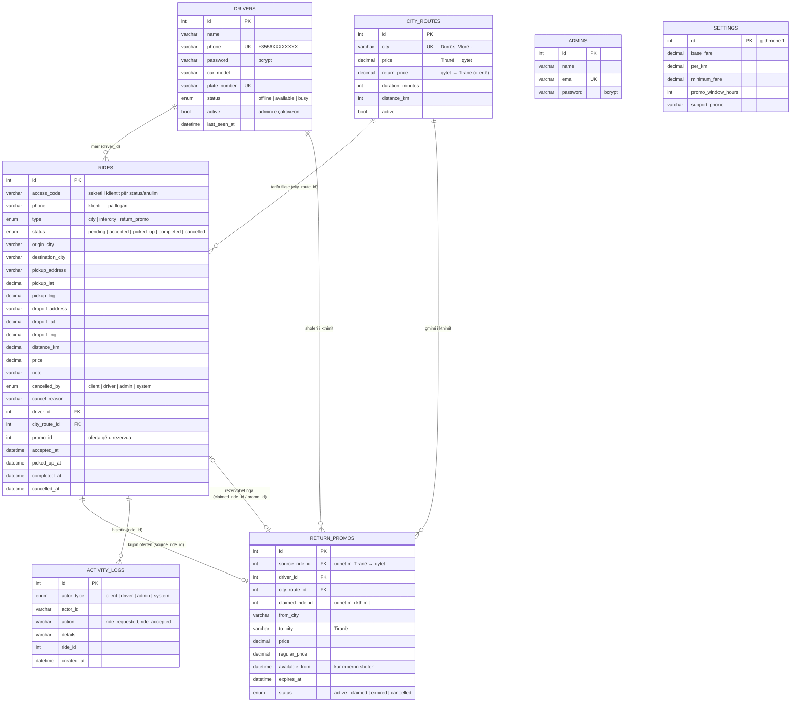
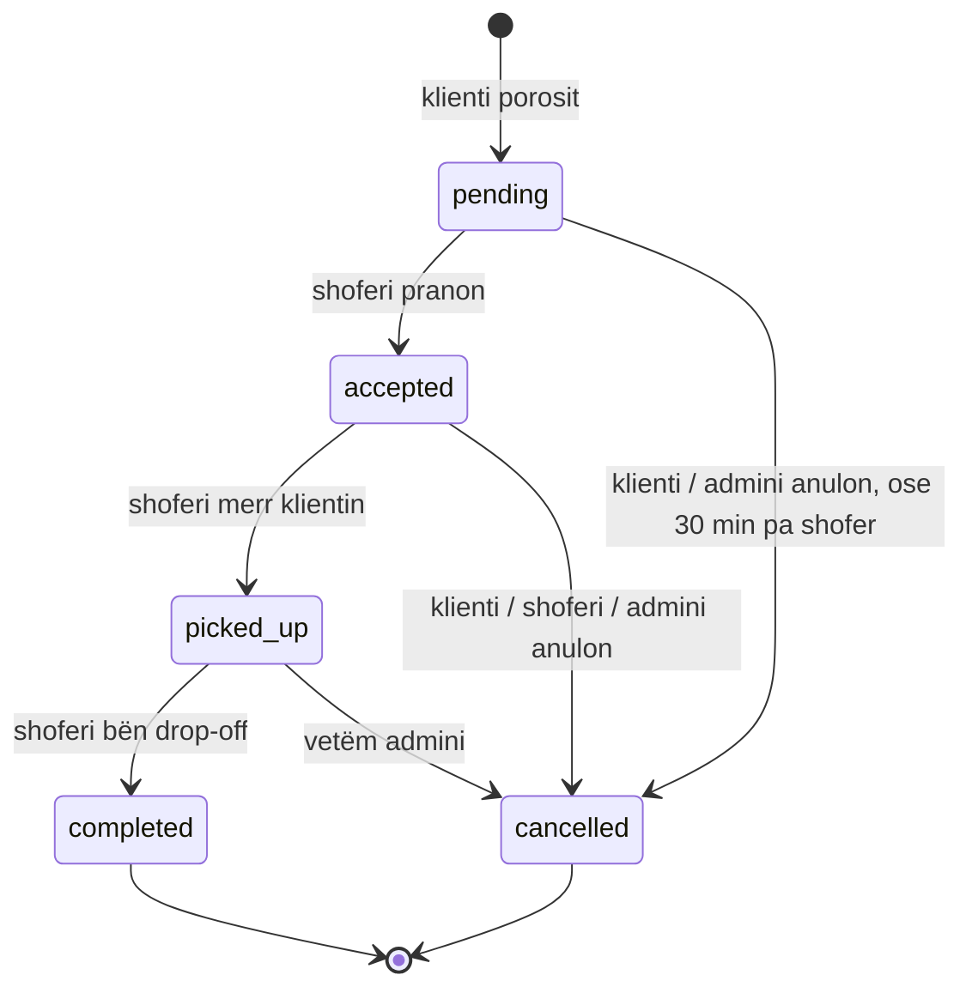
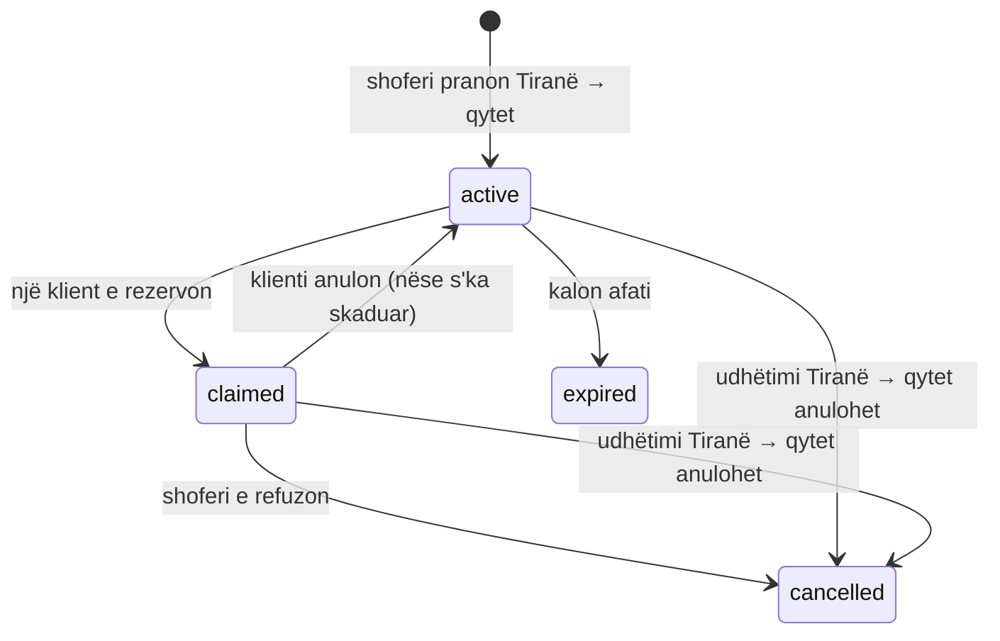

# Skema e databazës (MySQL + Sequelize)

Databaza ka 7 tabela. Backend-i i krijon vetë kur niset (`sequelize.sync()`), kështu që mjafton të krijosh databazën bosh dhe të vendosësh të dhënat në `backend/.env`. Skedari [`schema.sql`](./schema.sql) ka të njëjtën skemë në SQL, për referencë ose për krijim manual.

## Diagrami ER

## Tabelat

| Tabela | Çfarë ruan | Model Sequelize |
|---|---|---|
| `admins` | Llogaritë e administratorëve (email + fjalëkalim bcrypt) | `models/adminModel.js` |
| `drivers` | Shoferët: telefoni (për hyrje), makina, targa, statusi live | `models/driverModel.js` |
| `city_routes` | Tarifat fikse Tiranë → qytet dhe çmimi i kthimit | `models/cityRouteModel.js` |
| `rides` | Çdo porosi e klientit, nga kërkesa deri në drop-off ose anulim | `models/rideModel.js` |
| `return_promos` | Ofertat e kthimit qytet → Tiranë | `models/returnPromoModel.js` |
| `activity_logs` | Çdo veprim në sistem, për panelin admin | `models/activityLogModel.js` |
| `settings` | Një rresht me tarifat brenda Tiranës | `models/settingModel.js` |

## Lidhjet (`models/index.js`)

| Lidhja | Kolona | Kur fshihet prindi |
|---|---|---|
| `drivers 1 — N rides` | `rides.driver_id` | `SET NULL` (porosia mbetet në histori) |
| `city_routes 1 — N rides` | `rides.city_route_id` | `SET NULL` |
| `rides 1 — 1 return_promos` | `return_promos.source_ride_id` | `SET NULL` |
| `drivers 1 — N return_promos` | `return_promos.driver_id` | `SET NULL` |
| `city_routes 1 — N return_promos` | `return_promos.city_route_id` | `SET NULL` |
| `return_promos ↔ rides` (rezervimi) | `return_promos.claimed_ride_id`, `rides.promo_id` | pa FK (lidhje ciklike) |
| `rides 1 — N activity_logs` | `activity_logs.ride_id` | pa FK (log-u ruhet gjithmonë) |

## Statuset e porosisë

Statusi i shoferit lëviz bashkë me porosinë: `available` → (pranon) → `busy` → (drop-off ose anulim) → `available`. Shoferi kalon vetë `available` ↔ `offline` vetëm kur nuk ka udhëtim aktiv.

## Oferta e kthimit

- `available_from` = koha e pranimit + `city_routes.duration_minutes` (kur mbërrin shoferi në qytet)
- `expires_at` = `available_from` + `settings.promo_window_hours`
- Kërkesa e kthimit krijohet si `rides.type = 'return_promo'` me `driver_id` të vendosur, ndaj e sheh **vetëm ai shofer**.
